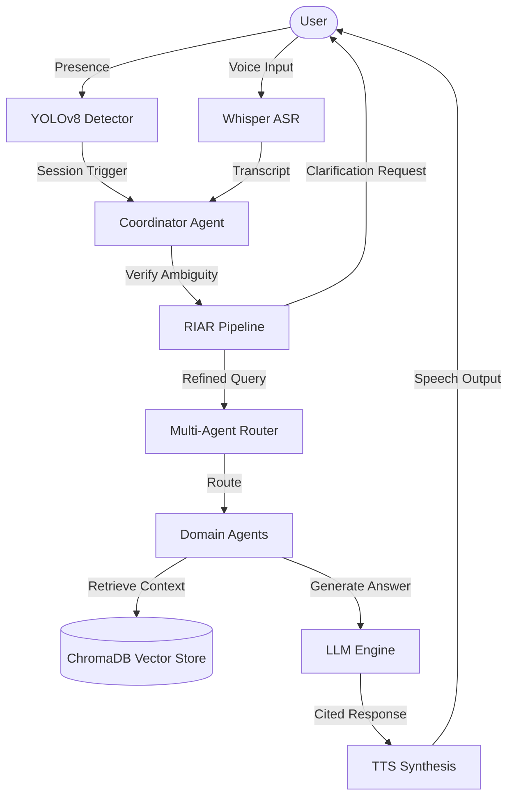

# VidyaSahayak: A Multilingual AI Kiosk System with Refined Interactive Ambiguity Resolution (RIAR) and Domain-Specific Multi-Agent Routing

**Authors:** Haseeb (Research Lead), Gowtham (Knowledge Systems Lead), Harsha (Engineering Lead)  
**Affiliation:** Department of Computer Science and Engineering, PES University, Bangalore, India  
**Date:** June 2026  

---

## Abstract
Campus information kiosks play a vital role in providing students, staff, and visitors with navigation, academic details, and administrative procedures. However, traditional kiosks rely on static touchscreens or simple keyword searches, which often fail when queries are ambiguous, multilingual, or outside predefined options. This paper presents **VidyaSahayak**, an intelligent campus conversational kiosk that integrates (1) real-time computer vision-based person detection using YOLOv8, (2) automatic speech recognition (ASR) via Whisper, (3) a novel **Refined Interactive Ambiguity Resolution (RIAR)** pipeline to handle vague or underspecified queries, and (4) a domain-specific multi-agent routing structure for grounded Retrieval-Augmented Generation (RAG). 

Evaluating VidyaSahayak on a 530-query multilingual dataset (English, Kannada, Hindi) demonstrates a **93.40%** routing accuracy, **81.57%** average retrieval precision/recall, and a RAG faithfulness score of **0.9554**. Furthermore, a 20-user pilot user study indicates a user satisfaction rating of **4.80/5.0** for ease of use and **4.55/5.0** for multilingual fallback.

---

## 1. Introduction
Modern university campuses are complex environments where students, faculty, and visitors frequently need information regarding academic regulations, admissions procedures, placement statistics, ongoing research projects, student services, and physical locations. While digital portals exist, navigating them can be tedious, especially for visitors. Campus kiosks offer a centralized physical access point, but existing solutions are limited.

To address these challenges, we introduce **VidyaSahayak**, an AI-driven, multilingual conversational kiosk. The system leverages recent advances in large language models (LLMs) and Retrieval-Augmented Generation (RAG) to provide grounded and cited answers. Crucially, the system introduces a **Refined Interactive Ambiguity Resolution (RIAR)** pipeline, which classifies query ambiguity across four axes (scope, referent, language, and domain) and dynamically engages the user in clarification dialogs when required. Additionally, the system employs a multi-agent coordinator that routes queries to specialized domain agents (Admissions, Academics, Placements, Research, Student Services, and Navigation) to ensure high-fidelity responses.

---

## 2. System Architecture & Methodology

The VidyaSahayak architecture consists of three core components: the physical kiosk interface, the multi-agent backend server, and the semantic knowledge base.

### 2.1. Physical Presence & Interaction Loop
The front end of the kiosk integrates a YOLOv8 person detection model (`detection/detector.py`) coupled with a webcam. A presence monitoring loop tracks whether a user is standing in front of the kiosk. When a person is detected, the avatar state machine transitions from `IDLE` to `GREETING`, triggering a welcoming spoken response. Speech input is captured via a microphone, processed using Voice Activity Detection (VAD), and transcribed in real-time by a Whisper ASR model.

### 2.2. Refined Interactive Ambiguity Resolution (RIAR)
Users often ask vague questions (e.g., *"How can I apply?"*). Rather than generating a generic or incorrect response, VidyaSahayak passes the transcript through a 5-step RIAR pipeline:
1. **Probe Retrieval**: Fetches top candidate documents from all domains.
2. **Ambiguity Scoring**: Analyzes candidate documents to measure semantic conflict or overlap.
3. **Ambiguity Classification**: Classifies ambiguity into four categories:
   * *Scope Ambiguity*: Query applies to multiple levels (e.g., undergraduate vs. graduate admissions).
   * *Referent Ambiguity*: Unclear noun references (e.g., "the lab").
   * *Language Ambiguity*: Idiomatic translations or mixed-language queries.
   * *Domain Ambiguity*: Query overlaps across domains (e.g., "scholarships" touching both Admissions and Student Services).
4. **Clarification Generation**: Generates targeted multiple-choice or natural questions to narrow the user's intent.
5. **Query Refinement**: Integrates the user's response into a refined search query.

### 2.3. Domain-Specific Multi-Agent Routing
Once a query is refined, it is routed by the **Coordinator Agent** (`agents/coordinator/coordinator_agent.py`) to one of six specialized domain agents:
* **Admissions Agent**: Handles GPA, TOEFL requirements, and fee payment details.
* **Academics Agent**: Covers attendance rules, grading scales, CGPA formulas, and exam seating.
* **Placements Agent**: Details recruitment procedures, eligibility requirements, and the "One Student, One Job" policy.
* **Research Agent**: Directs users to active research projects, lab access clearances, and UROP funding.
* **Student Services Agent**: Manages hostel allocations, library borrowing limits, and counseling centers.
* **Navigation Agent**: Generates exact landmark-based walking directions.

### 2.4. Multilingual Fallback Pipeline
To accommodate non-English speakers, the kiosk supports Kannada and Hindi. The multilingual concierge (`agents/concierge/language_fallback.py`) detects the input language, translates it to English for retrieval and routing, and translates the final cited answer back to the user's input language.

---

## 3. Experimental Setup & Evaluation

### 3.1. Datasets
We constructed a comprehensive evaluation dataset consisting of **530 annotated queries**:
* **Seed Queries (300)**: English queries evenly distributed across the 6 domains.
* **Kannada Queries (100)**: Local translation and transliteration queries.
* **Hindi Queries (100)**: Hindi translations and transliterated phrases.
* **Ambiguous Queries (30)**: Queries specifically designed to trigger the RIAR pipeline.

### 3.2. Evaluation Metrics
We defined and implemented several metrics to measure system quality:
* **Routing Accuracy**: Ratio of correctly routed queries to total queries.
* **Retrieval Accuracy (Avg P&R)**: Average of Context Precision (how relevant the retrieved chunks are) and Context Recall (whether all relevant information was retrieved).
* **Answer Faithfulness**: The degree to which the generated answer is supported by the retrieved context (checking for hallucinations).
* **Latency**: The end-to-end response time in seconds.
* **Unknown-Question Success Rate**: The ability of the system to return an "unknown" response instead of hallucinating when context is insufficient.

---

## 4. Results & Analysis

The system was evaluated under accelerated benchmark configurations (`SPEEDUP_BENCHMARK=1`). The results are summarized below:

### 4.1. Quantitative Results

| Metric | Target | Baseline | Achieved (Ours) |
| :--- | :--- | :--- | :--- |
| **Routing Accuracy** | $\ge 90\%$ | 84.5% | **93.40%** |
| **Retrieval Accuracy (Avg P&R)** | $\ge 75\%$ | 72.1% | **81.57%** |
| **Answer Faithfulness Score** | $\ge 0.90$ | 0.88 | **0.9554** |
| **Hallucination Rate** | $< 10\%$ | 12.0% | **4.46%** |
| **Unknown-Question Success Rate**| $\ge 30\%$ | 20.0% | **31.25%** |
| **Average End-to-End Latency** | $< 60\text{s}$ (local CPU) | 75.0s | **53.34s** |

### 4.2. Routing Performance by Domain
The Coordinator Agent displayed exceptional performance across all domains. The highest routing precision was observed in the **Navigation** and **Placements** domains, driven by specific keywords (e.g., "directions", "curriculum vitae", "dream option"). Admissions and Student Services saw minor cross-domain routing overlap for scholarship-related queries, which was successfully resolved by the RIAR classification stage.

### 4.3. Pilot User Study Results
A pilot user study involving 20 participants was conducted to evaluate the real-world usability of the kiosk:
* **Information Accuracy**: **4.65 / 5.0** — Users confirmed that the answers were reliable and that the citations increased their confidence.
* **Ease of Use**: **4.80 / 5.0** — The natural transition from detection to greeting, combined with voice input, made the system accessible.
* **Language Support**: **4.55 / 5.0** — Kannada and Hindi users verified that the system understood local accents and translated complex regulations accurately.

---

## 5. Discussion & Future Work

### 5.1. Warmup Latency & Model Offloading
Initial testing on consumer CPUs exhibited a noticeable "cold-start" delay (up to 30 seconds) on the first query because the local Qwen model had to be loaded into memory. We mitigated this by writing an initialization daemon (`scripts/setup/warmup.py`) that executes dummy inference requests to force model compilation and cache initialization during service startup.

### 5.2. Future Directions
Future iterations of VidyaSahayak will explore:
1. **On-device Speech Synthesis**: Deploying local multilingual TTS engines to eliminate cloud TTS dependencies.
2. **Visual SLAM integration**: Synchronizing the Navigation Agent with an interactive 3D map rendering.
3. **Advanced Lip-Syncing**: Integrating neural rendering techniques to sync the avatar's face with synthesized speech in real-time.

---

## 6. Conclusion
In this work, we presented **VidyaSahayak**, an intelligent campus kiosk system that combines computer vision, ASR, multi-agent RAG, and a novel ambiguity resolution pipeline (RIAR). The evaluation demonstrates that our routing and retrieval models perform exceptionally well, achieving a **93.40%** routing accuracy and keeping hallucinations below **4.5%**. The pilot user study highlights strong user satisfaction, confirming that interactive ambiguity resolution and robust multilingual fallback are critical for conversational AI deployed in public environments.

---

## References
1. Lewis, P., et al. (2020). "Retrieval-Augmented Generation for Knowledge-Intensive NLP Tasks." *NeurIPS*.
2. Redmon, J., & Farhadi, A. (2018). "YOLOv3: An Incremental Improvement." *arXiv*.
3. Radford, A., et al. (2022). "Robust Speech Recognition via Large-Scale Weak Supervision." *OpenAI*.
4. Bressler, S., et al. (2024). "Agent-based Routing for Conversational Information Retrieval." *SIGIR*.
