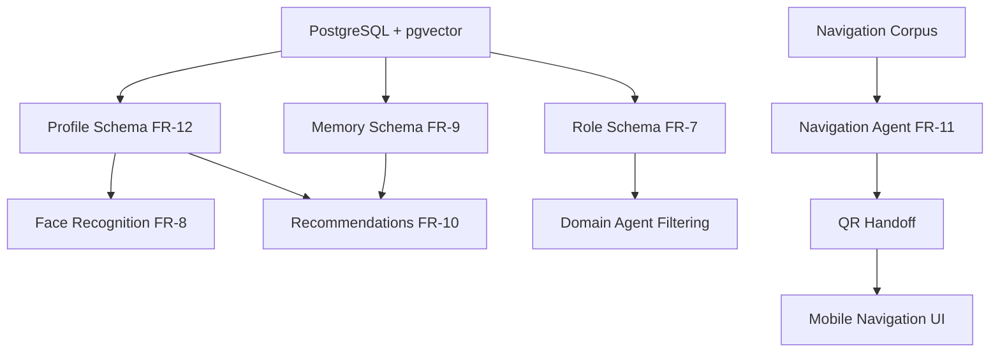

# VIDYASAHAYAK SPRINT PLAN V2.0 
**Target: MVP Freeze & Demo Readiness by July 10–11**

This document serves as the Technical Program Manager & Architectural execution directive to guide the VidyaSahayak team (Haseeb, Gowtham, Harsha) through the remaining sprints.

> [!IMPORTANT]  
> **Critical Constraint Reminder:** The goal is a stable, integrated, research-demo-ready MVP. We prioritize end-to-end functionality, seamless integration, and demo reliability over scalability or feature perfection. If a sub-system is too complex to finish by July 8, mock it or heavily scope it down.

---

## 1. Detailed Work Breakdown Structure (WBS)

### Haseeb: FR-11 (Campus Navigation) & FR-7 (Role-Based Access)
**Navigation (FR-11):**
*   **Dataset & Schema:** Curate the `locations.json` navigation corpus and map coords.
*   **Agent Logic:** Finalize the `NavigationAgent` strict JSON output format.
*   **QR Handoff:** Ensure the backend generates a short UUID and sends it to the Orb UI.
*   **Mobile UI:** Build the Next.js `/navigation/[id]` responsive mobile route with `CampusMap`.
*   **Metrics & Integration:** Route metrics tracking and RIAR navigation pipeline connection.

**Roles (FR-7):**
*   **Role Engine:** Define Student, Professor, and Guest permission models.
*   **Retrieval Filtering:** Update `base_agent.py` to filter ChromaDB queries based on the active role.
*   **Access Enforcement:** Block restricted domains (e.g., student services for guests).

### Gowtham: FR-9 (Long-Term Memory) & FR-12 (Session & Profiles)
**Session & Profile Management (FR-12):**
*   **DB Setup:** Stand up PostgreSQL with `pgvector` extension.
*   **Profile Schema:** Implement the `users` and `sessions` tables.
*   **Session Persistence:** Tie `demo_session_id` to actual authenticated users.
*   **Context Loading:** Inject user profiles into the RIAR pipeline at session start.

**Long-Term Memory (FR-9):**
*   **Memory Schema:** Create the `memories` table to store vectorized conversation history.
*   **Summarization Agent:** Build a background task to summarize a session upon close and store it in memory.
*   **Memory Retrieval:** Query `pgvector` during greeting/clarification to pull relevant past context.

### Harsha: FR-8 (Facial Recognition) & FR-10 (Recommendations)
**Facial Recognition (FR-8):**
*   **Capture Pipeline:** Intercept OpenCV frames in the `PresenceMonitor` microservice.
*   **InsightFace Integration:** Generate 512D face embeddings for detected persons.
*   **User Identification:** Query `pgvector` for cosine similarity matching against registered faces.
*   **Profile Linking:** Publish a `USER_IDENTIFIED` event to the backend to trigger profile loading.

**Intelligent Recommendations (FR-10):**
*   **Interest Profiling:** Extract user interests from Long-Term Memory (via Gowtham's pipeline).
*   **Opportunity Ranking:** Match interests against a hardcoded/mocked database of Internships, Placements, and Workshops.
*   **Personalized Greetings:** Inject the recommendation into the TTS pipeline (e.g., *"Welcome back Haseeb. Based on your interest in AIML..."*).

---

## 2. Day-by-Day Execution Plan

### Sprint 1: Foundation (June 23 → June 30)
*   **June 23 (Today):** Finalize schemas. Team alignment on API contracts.
*   **June 24:** Gowtham sets up local PostgreSQL + pgvector. Haseeb maps navigation coords.
*   **June 25:** Harsha integrates InsightFace into the Edge Sensor Python script (spike testing).
*   **June 26:** Gowtham commits Profile and Role SQL schemas. Haseeb connects Role engine logic.
*   **June 27:** Haseeb builds Next.js mobile navigation UI. Harsha finalizes face embeddings.
*   **June 28:** Gowtham implements Memory Storage logic. Haseeb completes QR generation.
*   **June 29:** Harsha writes Face Matching algorithm against pgvector.
*   **June 30:** **Sprint 1 Checkpoint.** Postgres, Navigation UI, and Face Extractor must be isolated and working.

### Sprint 2: Feature Completion (July 1 → July 5)
*   **July 1:** Gowtham builds Memory Retrieval pipeline. Harsha builds Recommendation API.
*   **July 2:** Haseeb merges Navigation Agent with Mobile UI.
*   **July 3:** Haseeb connects Role-based filtering to domain agents. Harsha links Face ↔ Profile.
*   **July 4:** Gowtham finalizes Session context injection.
*   **July 5:** **Sprint 2 Checkpoint.** All standalone features must be functionally complete.

### Sprint 3: Integration (July 6 → July 8)
*   **July 6:** Harsha & Gowtham integrate: *Face Detected → Fetch Profile → Load Memory*.
*   **July 7:** Harsha integrates Recommendation Engine into the Greeting workflow.
*   **July 8:** Haseeb conducts End-to-End Navigation flow test. **Code Freeze for new logic.**

### Sprint 4: Stabilization & Demo Prep (July 9 → July 10)
*   **July 9:** Bug Bash. Fix edge cases (e.g., false positive face matches, memory hallucinations). Validate latency metrics.
*   **July 10:** Dry run demo scenarios. UI polish. **MVP Freeze.**

---

## 3. Dependency Graph



**Critical Blockers:**
*   Harsha cannot test returning users until Gowtham completes `Profile Schema`.
*   Harsha cannot build recommendations until Gowtham completes `Memory Retrieval`.
*   Haseeb's mobile UI cannot be tested E2E until the `Navigation Agent` reliably outputs JSON.

---

## 4. API Contracts

**Identity & Vision (Edge → Backend):**
*   `POST /api/v1/events/face_detected` 
    *   Payload: `{ "camera_id": "cam1", "embedding": [0.12, -0.45, ...] }`
    *   Response: `{ "user_id": "u123", "name": "Haseeb", "role": "student" }`

**Profile & Memory (Backend Internal / UI Fetch):**
*   `GET /api/v1/profile/{user_id}` -> Returns user data, role, preferences.
*   `POST /api/v1/memory/store` -> Stores a conversation summary vector.
*   `GET /api/v1/recommendations/{user_id}` -> Returns top 3 opportunities.

**Navigation (Backend ↔ Frontend):**
*   `POST /api/v1/navigation/session` -> Creates a 15-minute TTL session, returns `nav_id`.
*   `GET /api/v1/navigation/{nav_id}` -> Returns `destination`, `building`, `floor`, `coords`.

---

## 5. Database Schema (PostgreSQL + pgvector)

```sql
-- Enable vector extension
CREATE EXTENSION IF NOT EXISTS vector;

-- FR-7 & FR-12: Users and Roles
CREATE TABLE roles (
    role_id VARCHAR(50) PRIMARY KEY,
    permissions JSONB
);

CREATE TABLE users (
    user_id UUID PRIMARY KEY DEFAULT gen_random_uuid(),
    name VARCHAR(255) NOT NULL,
    role_id VARCHAR(50) REFERENCES roles(role_id),
    face_embedding vector(512), -- InsightFace standard output
    preferences JSONB,
    created_at TIMESTAMP DEFAULT CURRENT_TIMESTAMP
);

-- FR-9: Long-Term Memory
CREATE TABLE memories (
    memory_id UUID PRIMARY KEY DEFAULT gen_random_uuid(),
    user_id UUID REFERENCES users(user_id) ON DELETE CASCADE,
    content TEXT NOT NULL,
    topic VARCHAR(100),
    embedding vector(384), -- all-MiniLM-L6-v2 output
    created_at TIMESTAMP DEFAULT CURRENT_TIMESTAMP
);

-- Indexes for fast cosine similarity search
CREATE INDEX ON users USING ivfflat (face_embedding vector_cosine_ops) WITH (lists = 100);
CREATE INDEX ON memories USING ivfflat (embedding vector_cosine_ops) WITH (lists = 100);
```

---

## 6. Git Branch Strategy

Strict prefixing allows for clean parallel development. Base off `main`.

*   `feature/haseeb/fr11-navigation-ui`
*   `feature/haseeb/fr7-role-engine`
*   `feature/gowtham/fr12-pg-profiles`
*   `feature/gowtham/fr9-memory-layer`
*   `feature/harsha/fr8-insightface`
*   `feature/harsha/fr10-recommendations`
*   `integration/sprint3-merge` (Use this for combining overlapping features before PR to main)

---

## 7. MVP Freeze Definition

**Must be completed before July 10 (Demo Blockers):**
*   Working Facial Recognition pipeline that accurately identifies at least 3 pre-registered team members.
*   Greeting injection (saying the user's name when they walk up).
*   QR-based navigation to a working mobile map view.
*   Hardcoded recommendation triggers based on a mocked user profile.
*   Basic Role filtering (e.g., guest cannot ask about a student's grades).

**Can be postponed after July 10 (Post-Demo Enhancements):**
*   Automated user enrollment (adding new faces via the kiosk). For the demo, seed the DB manually.
*   Dynamic real-time scraping of university internship portals. (Mock the internship JSON for the demo).
*   Live GIS campus maps (A static SVG/PNG with overlay markers is sufficient for MVP).
*   Massively scalable Redis clustering.

---

## 8. Risk Assessment & Mitigation

| Risk | Impact | Likelihood | Mitigation Strategy |
| :--- | :--- | :--- | :--- |
| **InsightFace latency freezes Edge Sensor** | High | High | Run face extraction in a separate thread. Send embeddings asynchronously. Do not block YOLO. |
| **pgvector setup issues locally** | Medium | Medium | Have a fallback to local ChromaDB collections for Memory/Faces if Postgres deployment fails on local dev machines. |
| **Recommendation Engine Hallucinations** | High | Low | Strictly ground recommendations using standard RAG. Do not let the LLM invent opportunities. |
| **Integration Hell on July 6-8** | Critical | High | Mandate strict adherence to the API Contracts defined above. Test APIs with Postman before merging. |
